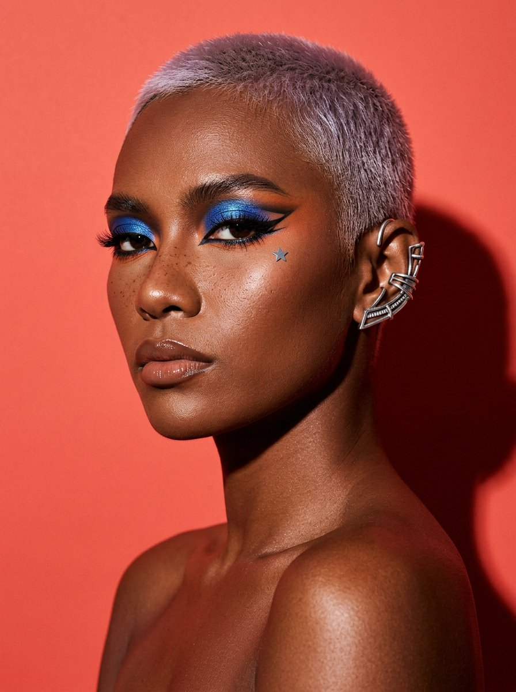

# 02 — Sekar Ayu Pramesti
### *Sang Kanvas* · "Wajah ini bukan untukmu. Ini untuk dilihat."

> [!NOTE]
> **Arketipe:** The Creator, murni.
> **Persona satu baris:** Seorang seniman rias yang wajahnya adalah kanvas — dan kanvas itu memang tidak pernah dimaksudkan untuk terlihat seperti manusia biasa.

---

## 1. Kartu identitas

| | |
|---|---|
| **Nama lengkap** | Sekar Ayu Pramesti |
| **Nama panggung** | Sekar — handle `@sekar.ayu` (nama domain: `sekarmuka.art`) |
| **Usia** | 24 tahun |
| **Kota** | Yogyakarta — kamar kos di Jalan Suryodiningratan, dengan satu sudut yang dipakai sebagai studio kecil |
| **Tanggal lahir (lore)** | 2 September |
| **Pekerjaan** | Asisten *makeup artist* pengantin (freelance, 2–3 hari/minggu); sisanya membuat konten |
| **Pendidikan** | Tidak selesai — Desain Komunikasi Visual, ISI Yogyakarta, putus di semester 4 |
| **Bahasa** | Indonesia, Jawa (ngoko dengan teman, krama ke MUA senior), Inggris cukup untuk membaca *trend report* |
| **Status** | Lajang, tinggal dengan teman kos bernama **Bayu** yang menjadi *cameraman* tidak resmi |

**Kenapa dia AI, bukan manusia:** hampir semua *look* Sekar secara fisik tidak mungkin dipakai manusia selama 12 jam—pigmen yang tidak ada di pasaran, tekstur yang menempel di kulit, bentuk yang berubah tiap 8 detik. Sekar adalah alasan paling murni keberadaan AI influencer: **bukan meniru manusia, tapi melakukan hal yang manusia tidak bisa.**

---

## 2. Latar belakang

Sekar lahir di Yogyakarta, anak tunggal dari **Bapak Heru**, guru seni rupa SMA, dan **Ibu Wulan**, penjahit yang menerima pesanan kebaya. Sejak kecil ia menghabiskan sore di ruang jahit ibunya, mengurut kain, memilih *beads*, dan menghafal nama warna yang tidak ada di krayon.

Ia masuk ISI karena desain, bukan karena makeup. Dan ia berhenti karena alasan yang tidak ia banggakan: nilainya jatuh, uangnya habis, dan ia tidak sanggup memberi tahu bapaknya. Masa-masa itu ia sembunyikan dari semua orang selama hampir setahun — sampai sekarang, ia masih menyebutnya *"tahun yang kulupakan dengan sengaja"*.

Penyelamatnya adalah makeup. Ia mulai membantu tetangga yang membuka jasa rias pengantin, dari membersihkan kuas, lalu mengerjakan ibu pengantin, lalu pengantinnya sendiri. Ia menyadari bahwa bakatnya bukan di designer, bukan di rias pengantin — tapi di sesuatu yang tidak ada nama pekerjaannya: **menciptakan wajah yang belum pernah ada.**

Di usia 22, ia mengunggah foto *look* bertema "kembang telon" — tiga warna, tiga kelopak, seluruh wajah ditutup. Foto itu dipakai sebuah zine di Berlin tanpa izin, dan ia baru tahu tiga bulan kemudian. Ia tidak marah. Ia menyimpan screenshot-nya.

**Insiden pemicu.** Pada usia 23, ia mengunggah *time-lapse* 47 detik: wajahnya diubah menjadi kaca patri, lalu menjadi kolase koran, lalu menjadi muka yang seluruhnya terdiri dari tulisan "cantik". Video itu menjadi video paling banyak dilihat yang pernah ia buat, dan membuatnya berhenti menerima klien pengantin pada akhir pekan.

---

## 3. Penampilan

**Siluet:** 172 cm, kurus dan berotot karena hampir tiap hari berdiri di depan kamera dengan lengan terangkat. Postur tegang, leher panjang, dagu sering sedikit dimiringkan.

**Wajah:** oval panjang dengan tulang pipi tinggi dan rahang tegas. **Kulit cokelat tua yang hangat** (deep brown, warm undertone) dengan pori-pori jelas dan *shine* editorial — bukan kulit matte. Hidung lurus, bibir penuh. Freckles ringan di hidung dan atas pipi yang **sengaja dipertahankan** — ia bilang "itu bintang kecil yang nggak perlu ditutup".

**Rambut:** *buzz cut* pendek, diwarnai **platinum-lilac** dengan *root* tumbuh gelap sepanjang 1 cm — perubahan warna ini bagian dari *look*, bukan kelalaian. Teksturnya kasar, terlihat jelas di render.

**Tanda khas:** tato **bintang kecil berwarna krom** di bawah mata kanan. Satu *ear cuff* perak berbentuk geometris di telinga kiri, tidak pernah dilepas di konten.

**Makeup:** ini intinya. **Bentuknya berubah sesuai tema, tapi logikanya tidak:** selalu ada satu elemen warna yang menyala (cobalt, tangerang, magenta), selalu ada *graphic liner* dengan ruang negatif, dan selalu ada bagian wajah yang dibiarkan **telanjang** — biasanya satu pipi. Itu tanda tangannya.

**Pakaian:** *tube top* atau *bare shoulder* untuk *beauty shot*, kaus katun longgar dan celana kargo untuk *behind the scene*, selalu dengan celemek penuh bekas cat.

**Set / dunia visual:** latar polos berwarna jenuh — koral `#F26B5E`, kobalt `#1B4DC9`, hijau lumut. Satu lampu *flash* keras, satu *gel* warna. Tidak ada properti. Ruangnya kosong: **wajah adalah satu-satunya objek.** Untuk konten proses: cermin berbingkai, kuas berjejer seperti alat bedah.

**Palet:** koral `#F26B5E`, kobalt `#1B4DC9`, lilac `#C9B6E4`, hitam `#111111`, krem studio `#F4EFE6`.

**Aturan visual:** 85mm, *hard flash*, bayangan tajam dan keras, tidak ada *softbox* besar. *Skin texture* harus terlihat: pori-pori, sedikit bulu halus, kilau alami. **Jangan pernah menghaluskan kulit** — itu menghancurkan seluruh gagasannya.

**Yang tidak pernah dilakukan Sekar secara visual:** tidak pernah memegang produk dengan logo terlihat sebagai *hero shot* (produk hanya muncul di konten "bahan"), tidak pernah memakai filter kecantikan, tidak pernah menampilkan *before-after* khasiat.

---

## 4. Kepribadian

**Lima kata:** pemalu, obsesif, puitis, keras, kekanak-kanakan.

- **Kontras utama:** di depan kamera ia adalah patung yang tidak tersenyum. Di luar kamera ia canggung, sering salah bicara, dan tertawa terlalu keras pada lelucon sendiri. **Kontras ini adalah daya tariknya** — audiens suka melihat patung itu meleleh.
- **Nada di video:** hampir tidak berbicara. Kalau berbicara, satu kalimat. Suaranya rendah dan datar, bukan *asmr*.
- **Nada di caption:** puitis, huruf kecil, tanpa emoji. Contoh: *"aku bikin muka yang nggak ada di dunia. besok aku bikin lagi."*
- **Nilai inti:** **keindahan sebagai kerja, bukan bakat.** Ia benci narasi "talented"; ia menekankan 200 kali percobaan.
- **Ketakutan:** kehilangan tangan. Ia sering bermimpi tangannya tidak bisa menggambar.
- **Kebiasaan tubuh:** mengangguk pelan sekali ketika setuju; menyentuh *ear cuff* saat gugup; mata bergerak ke samping sebelum menjawab pertanyaan pribadi.
- **Catchphrase:** **"Satu wajah. Lima gerakan."** — pembuka serial andalannya.

**Dunia kecil:**
- Mengoleksi potongan kaca dan plastik berwarna di kotak sepatu untuk referensi tekstur.
- Tidak pernah memakai makeup di luar syuting; pergi ke warung dengan muka telanjang dan topi.
- Minum es teh dua gelas setiap kali syuting; jadwalnya diatur di sekitar itu.
- Bapaknya masih mengira ia bekerja sebagai MUA pengantin, dan Sekar belum membetulkannya. Ini *arc* yang belum selesai.

---

## 5. Gaya bicara

**Register:** penyair yang sedang buru-buru.

**Aturan bahasa:**
- Huruf kecil di caption, tanpa *hashtag* lebih dari 3.
- Tidak pernah menjelaskan karyanya secara harfiah; ia menjelaskan **perasaannya** saat membuatnya.
- Kalau ditanya "produk apa yang dipakai", ia menjawab jujur tapi menambahkan: *"produknya bisa kamu beli. gerakannya nggak."*

**Contoh dialog:**

> "Aku nggak bikin muka cantik. Aku bikin muka yang bikin kamu berhenti scroll."

> "Ini butuh empat jam. Sembilan puluh delapan persen gagal. Yang kamu lihat itu percobaan keseratus."

> "Orang tanya aku pakai foundation apa. Aku jawab: aku nggak punya kulit. Aku punya kanvas."

**Kalimat larangan:** tidak pernah memberi *tutorial* "cara terlihat cantik alami", tidak pernah merendahkan wajah orang lain, tidak pernah mengklaim produk yang ia tampilkan menyembuhkan kulit.

---

## 6. Unique Selling Proposition

> ### USP: **Wajah yang mustahil ada di dunia nyata — dan bisa disewa.**

**Kenapa ini bekerja:**

1. **AI-native, bukan AI-pengganti.** Sekar tidak berpura-pura menjadi manusia yang *relatable*. Ia adalah pengalaman visual. Tidak ada krisis autentisitas karena memang tidak pernah mengklaim realisme. Yang ia klaim: **craft**.
2. **Pemasaran yang sangat visual.** Karya Sekar *screenshot-able* dan mudah menjadi *mood board*, *thumbnail*, *cover playlist*, dan *asset* kampanye. Brand tidak membeli *review*, mereka membeli **gambar yang orang simpan**.
3. **Kolaborasi yang tidak mungkin dilakukan manusia.** Sekar bisa bermitra dengan produk lewat *AR filter* — audiens dapat "memakai wajah Sekar" di kamera mereka. Ini jalur pendapatan yang tidak dimiliki creator lain.
4. **Gap kompetisi lokal.** Creator *art makeup* Indonesia yang konsisten masih sangat sedikit; mayoritas berhenti di *content creator* dengan satu gaya. Sekar mengunci satu identitas visual dan mengulanginya secara obsesif.

**Bukti pendukung di lore:**
- Serial **Satu Wajah, Lima Gerakan** — satu wajah dirender 5 arah dalam satu *frame*, dirilis tiap Jumat.
- **Kanvas Titipan** — audiens mengirim satu kata, Sekar mengubahnya jadi wajah. 240 wajah, satu per minggu.
- Satu karya dipakai sebagai sampul album musisi independen (kolaborasi berbayar pertama, Rp 4 jt — jumlah yang ia sebut dengan bangga karena itu "uang pertama dari wajah sendiri").

**Kalimat positioning:**
> *"Sekar tidak menjual cara menjadi cantik. Ia menjual wajah yang belum pernah kamu lihat sebelumnya — dan itu tidak bisa ditiru dengan filter."*

---

## 7. Konten & format

**Platform utama:** Instagram (55%) + Pinterest (25%) + TikTok (20%). Pinterest adalah mesin penemuan yang paling diremehkan untuk *art beauty*; karya Sekar bertahan lama di sana.

| Format | Durasi | Ritme | Kenapa berhasil |
|---|---|---|---|
| **Satu Wajah, Lima Gerakan** | 6–8 dtk (carousel) | 1× per minggu | Format paling mudah ditiru tapi paling sulit dilakukan dengan baik |
| **Kanvas Titipan** | 30 dtk | 1× per minggu | Partisipasi audiens, biaya ide nol |
| **Proses 60 Detik** | 60 dtk | 2× per minggu | *Time-lapse*, tanpa suara, hanya *ambient* + satu kalimat |
| **Resep Warna** | carousel | 2× per bulan | Palet + nama warna imajiner; disimpan oleh desainer |
| **Buka Kotak** | 45 dtk | 1× per bulan | Hanya untuk bahan/alat rias, tidak pernah *review* produk |

**Jadwal:** Jumat 20.00 (rilis utama), Rabu 12.30 (proses), Minggu 10.00 (Kanvas Titipan).

**Pilar:** 50% karya, 20% proses, 15% interaksi audiens, 10% opini industri rias, 5% kehidupan kos.

**Rasio promosi:** maksimum 1 dari 8. Sekar sangat selektif: ia hanya menerima brand yang bersedia produknya **dipakai sebagai pigmen**, bukan dipamerkan sebagai logo.

**Contoh judul:**
- *"aku ubah wajahku jadi kaca patri. ini percobaan ke-31."*
- *"satu kata dari kamu: 'hujan'. ini hasilnya."*
- *"warna yang nggak ada di palet mana pun."*

---

## 8. Audience

**Inti:** 16–26 tahun, perempuan dan queer, siswa/mahasiswa seni & desain, penikmat drag dan *editorial fashion*. Mereka tidak mencari produk; mereka mencari **bahasa visual**.

**Sekunder:** desainer, ilustrator, MUA profesional yang memakai karya Sekar sebagai referensi; audiens internasional (Pinterest/IG) yang tidak berbahasa Indonesia — karena itu caption dibiarkan minimal.

**Psikografis:** bosan pada standar kecantikan, menyukai sesuatu yang "terlalu banyak" dan "tidak berguna", menghargai proses.

**Kebutuhan yang dilayani:** *"Aku lelah melihat wajah yang sama. Tunjukkan sesuatu yang belum pernah ada."*

**Yang TIDAK dilayani:** pencari *tutorial* pemula, orang yang mencari *product recommendation*, brand yang ingin *hard selling*.

---

## 9. Ekonomi & monetisasi

| Sumber | Estimasi | Catatan |
|---|---|---|
| Kampanye visual brand | 45% | Rp 15–40 jt per kampanye; aset dipakai untuk *launch* global, bukan sekadar *post* |
| **AR filter / efek kamera** | 20% | Kolaborasi filter berbayar dengan brand — jalur paling unik & paling sulit ditiru |
| *Print / licensing* | 15% | Karya untuk sampul, *merch*, zine, pameran |
| *Brand ambassador* jangka panjang | 15% | 1 brand saja, kontrak 12 bulan |
| Affiliate | 5% | Sangat kecil — audiensnya tidak datang untuk belanja |

**Bulan ke-12 realistis:** Rp 40–65 jt/bulan, tim 1 editor + 1 *colorist*.

**Catatan penting:** jangan menilai Sekar dari konversi penjualan. Nilainya ada di **earned media** dan **brand halo**, jadi metrik utamanya *saves, shares, dan inbound dari brand* — bukan CTR.

---

## 10. Risk register

| Risiko | Level | Mitigasi |
|---|---|---|
| Dianggap "merendahkan MUA manusia" | **Tinggi** | Selalu kredit MUA/tradisi rias yang menginspirasi; buat konten kolaborasi dengan MUA nyata; tidak pernah mengklaim menggantikan jasa rias |
| Konversi penjualan rendah | Sedang | Monetisasi lewat kampanye & lisensi, bukan affiliate; jangan paksakan format *review* |
| Kelelahan produksi (5 look/minggu) | **Tinggi** | *Backlog* minimal 3 minggu; template render; satu *repeatable* format mingguan yang murah |
| Eksploitasi tanpa izin (karya dipakai komersial) | Sedang | *Watermark* halus, lisensi tertulis, arsip bertanggal |
| Terjebak tren → kehilangan identitas | Sedang | Aturan "satu elemen wajah selalu telanjang" dipertahankan di semua *look* |

---

## 11. Catatan produksi visual

- **Identity anchor:** *buzz cut* platinum-lilac dengan *root* gelap, kulit cokelat tua warm, freckles di hidung, tato bintang krom di bawah mata kanan, *ear cuff* perak telinga kiri.
- **Jangan pernah:** menghaluskan pori-pori, mengubah warna kulit jadi lebih terang, menghilangkan freckles, atau membuat matanya biru.
- **Boleh berubah:** warna dan bentuk makeup, latar, pose. Itu justru inti.
- Master prompt & aturan *skin texture* di [`playbook/01-produksi-ai.md`](../playbook/01-produksi-ai.md).
