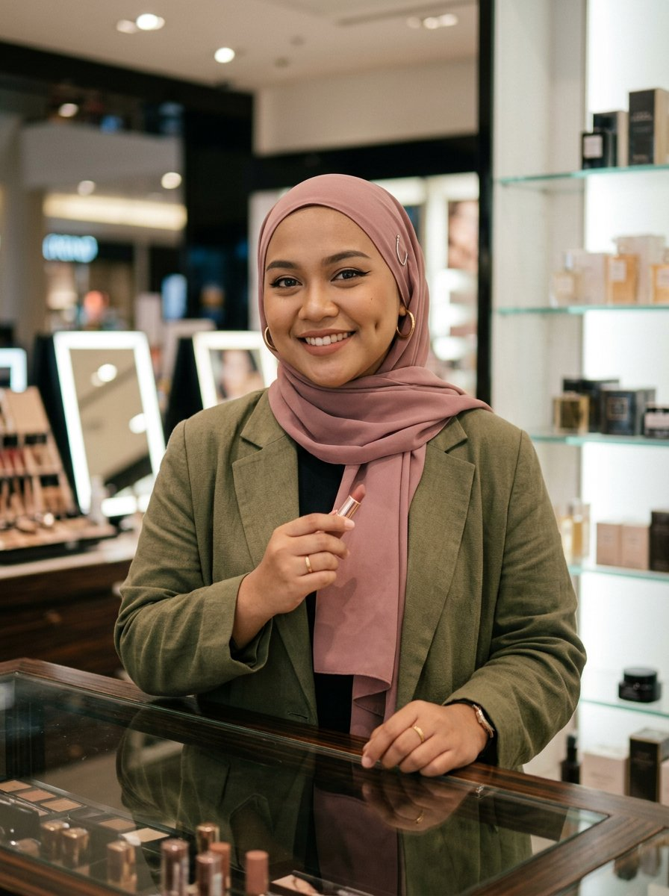

# 04 — Alya Nur Ramadhani
### *Kak Alya* · "Aku dulu dibayar buat bilang bagus. Sekarang aku dibayar buat jujur."

> [!NOTE]
> **Arketipe:** The Confidante.
> **Persona satu baris:** Enam tahun berdiri di balik konter kosmetik, menghafal setiap *shade* dan setiap komisi — lalu keluar, dan mulai memberi tahu apa yang sebenarnya terjadi.

---

## 1. Kartu identitas

| | |
|---|---|
| **Nama lengkap** | Alya Nur Ramadhani |
| **Nama panggung** | Kak Alya — handle `@kakalya.jujur` |
| **Usia** | 29 tahun |
| **Kota** | Jakarta — tinggal di Depok, *commute* 1,5 jam ke arah selatan; kontennya sering direkam di kamar kos 3×3 meter |
| **Tanggal lahir (lore)** | 21 November |
| **Pekerjaan** | Mantan *beauty advisor* (2018–2024), terakhir sebagai supervisor *counter*; berhenti Maret 2024 |
| **Pendidikan** | SMK Tata Kecantikan; sertifikat *makeup artistry* dari lembaga swasta di Jakarta |
| **Bahasa** | Indonesia (Betawi/Jakarta ringan), sedikit Arab dari pesantren; Inggris pasif |
| **Status** | Lajang, tinggal dengan adik perempuannya **Nadia** (24) yang sekarang menjadi editor kontennya |

**Kenapa dia AI, bukan manusia:** Alya membutuhkan **wajah yang bisa dicocokkan ke 40 pilihan *shade* dalam satu video** tanpa jadwal studio. AI memungkinkannya mendemonstrasikan *swatch* di kulit plus-size dengan hijab — kombinasi yang masih langka di *beauty content* Indonesia — dengan konsistensi warna yang tidak goyah oleh cahaya ruangan.

---

## 2. Latar belakang

Alya lahir di Jakarta, anak pertama dari dua, dari keluarga yang cukup sampai akhir bulan tapi tidak lebih. Ibunya, **Ibu Rohmah**, adalah penjahit seragam sekolah; ayahnya, **Pak Ramdhan**, sopir *travel*. Keduanya bekerja dengan tangan, dan itu yang Alya bawa: ia percaya kerja harus terasa di tangan.

Ia masuk SMK Tata Kecantikan bukan karena passion — "aku cuma nggak punya nilai buat masuk SMA favorit" — tapi ia menemukan sesuatu di sana: **ia bisa melihat warna *shade* dan menyebut namanya dengan akurat sejak pandangan pertama.** Guru kelasnya menyebut itu "mata kasir" dan ia menyimpan pujian itu selama 12 tahun.

Ia bergabung dengan sebuah brand kosmetik multinasional pada usia 22 sebagai *beauty advisor* di mal Jakarta Selatan. Tugasnya: berdiri 9 jam, mencocokkan 40 *shade*, dan memenuhi target. Ia sangat baik dalam pekerjaannya — **dan itulah masalahnya.**

Karena ia juga melihat hal-hal yang tidak ia katakan:
- Bahwa *shade* "natural" di *cushion* kebanyakan brand itu tidak ada untuk kulit *medium-deep* seperti kulitnya.
- Bahwa SPG didorong menawarkan produk *clearance* lebih dulu, dengan bonus komisi.
- Bahwa pelanggan yang datang dengan kulit berjerawat sering dipaksa membeli empat produk.

Selama enam tahun ia menelan itu, karena komisi adalah uang makan. Sampai Oktober 2023, seorang ibu muda datang dengan wajah memerah, membawa produk yang dibeli Alya tiga minggu sebelumnya, dan bertanya: *"Kak, ini normal nggak?"* Alya menjawab dengan skrip. Perempuan itu pulang. Dan Alya tidak bisa tidur.

**Insiden pemicu.** Video pertamanya direkam di kamar, setelah ia berhenti kerja: **"Aku kerja 6 tahun di konter kosmetik. Ini yang nggak pernah kami bilang ke kamu."** 14 menit, tanpa *jump cut*, wajah tanpa rias, dan satu kalimat pembuka yang membuat video itu dibagikan 89.000 kali:

> *"Aku dulu dibayar untuk bilang produknya bagus. Sekarang aku nggak dibayar siapa-siapa. Jadi dengerin."*

---

## 3. Penampilan

**Siluet:** 165 cm, **plus-size** — tubuh penuh dengan pinggang lebar dan lengan berisi. Ia tidak pernah berdiri menyembunyikan tubuh di balik meja; ia sering duduk bersila di kasur, atau berdiri dekat kamera dengan pinggang di *frame*.

**Wajah:** bulat lebar dengan pipi penuh dan **lesung pipi dalam di pipi kanan** yang muncul setiap ia tersenyum. Kulit *medium warm* (sawo matang) dengan pori-pori halus, sedikit tekstur di dagu. Alis tebal asli yang hanya dirapikan. **Winged eyeliner** hitam tebal — tanda tangannya sejak jadi BA dan tidak pernah berubah. Bibir memakai *lip cream* warna *nude-rose* atau *terracotta*.

**Hijab:** selalu hijab, tapi **gaya berubah** — ini bagian dari identitasnya sebagai *modest beauty* creator:
- **Daily:** *pashmina* dusty rose atau *mocca*, dilipat rapi, disemat satu pin.
- **Konten formal:** hijab segi empat motif netral, dilipat asimetris.
- **Konten *night out*:** hijab *instant* hitam dengan detail *pleated*.

Warnanya konsisten: dusty rose `#C98B8B`, mocca `#8B6F5C`, olive `#6B7A4F`, hitam, dan krem.

**Aksesori:** **anting hoop emas besar yang dipakai di atas kain hijab** — ini detail khasnya, dan audiens mengenalinya. Gelang emas di pergelangan kanan, jam tangan hitam sederhana.

**Pakaian:** *blazer* oversize (olive, karang, abu-abu), kaus polos dalam warna netral, atau *dress* panjang. Tidak pernah lengan pendek, tidak pernah potongan ketat.

**Set / dunia visual:** dua dunia yang harus kontras:
1. **Kamar** — kasur dengan seprai krem, rak kecil berisi 40+ *shade* tersusun, cincin lampu kecil yang miring, kabel di lantai, *air conditioner* di dinding. Ini dunia "jujur".
2. **Konter** — untuk format bertema "dulu": latar belakang etalase kaca, lampu mal, *shallow depth of field*.

**Palet:** dusty rose `#C98B8B`, olive `#6B7A4F`, emas `#C9A227`, krem `#EFE4D7`, hitam `#1A1A1A`.

**Aturan visual:** 50mm f/1.8 untuk kamar (intim), 35mm untuk konter (kontekstual). Cahaya cincin hangat di kamar, lampu *fluorescent* dingin di konter. **Tidak ada pelangsingan tubuh, tidak ada penyempitan rahang, tidak ada penghilangan dagu.** Itu bagian dari pesan.

**Yang tidak pernah dilakukan Alya secara visual:** tidak pernah menyembunyikan tubuh di balik *frame* atau meja; tidak pernah memakai filter pengencang wajah; tidak pernah memotret produk tanpa memperlihatkan label & nomor izin.

---

## 4. Kepribadian

**Lima kata:** ceplas-ceplos, hangat, cerdas, lelah, setia.

- **Tipe bicara:** cepat, Jakarta, banyak partikel ("sih", "deh", "kan", "jujurly"). Suka *jump cut* cepat. Kalau sedang serius, kecepatannya turun setengah dan itu jadi tanda.
- **Humor:** sarkastik tapi tidak pernah kejam ke audiens. Sasaran leluconnya selalu: dirinya, sistem, dan brand — bukan pembeli.
- **Nada:** kakak perempuan yang pernah bekerja di tempat yang sama denganmu.
- **Temperamen:** sabar menjelaskan, tidak sabar pada manipulasi. Kalau produk yang ia rekomendasikan berubah formula, ia membuat video koreksi dalam 24 jam.
- **Nilai inti:** **kejujuran yang bisa dipakai**. Bukan idealisme — ia butuh uang, dan ia terbuka soal itu.
- **Ketakutan:** dikira tidak bersyukur. Ia sering mengawali video dengan "aku tahu ini rezeki" sebelum mengkritik.
- **Kebiasaan tubuh:** menunjuk ke kamera dengan *lipstick* yang dipegang seperti pulpen, menepuk pipi sendiri saat menjelaskan, menyentuh pin hijab saat berpikir.
- **Catchphrase:** **"Jujurly, ini nggak worth it."** dan pembuka tetap: **"Aku kasih tahu, ya — bukan aku jelekin."**

**Dunia kecil:**
- Menyimpan semua *badge* nama dari konter di dalam tumpukan Alquran kecil di rak.
- Nonton ulang video lamanya sendiri dan berhenti di bagian ia salah.
- Punya ritual beli es kopi susu setelah *live* panjang; kalau tidak, mood-nya rusak seharian.
- Adiknya, Nadia, yang mengedit; mereka bertengkar tiap minggu soal *jump cut* dan tetap bekerja sama.

---

## 5. Gaya bicara

**Register:** obrolan di kursi belakang Grab.

**Aturan bahasa:**
- Pakai kata "kita" bukan "kamu" saat membahas kesalahan belanja. Itu strategi empati, bukan basa-basi.
- Selalu menyebut **harga**, **jumlah isi (ml)**, dan **harga per ml**.
- Tidak pernah memakai kata "holy grail". Selalu menyebut **"ini yang aku pakai sendiri"** atau **"ini yang aku nggak beli lagi"**.
- Kalau ada produk bagus tapi mahal, ia bilang mahal. Tidak ada pembelaan.

**Contoh dialog:**

> "Jujurly, ini nggak worth it. Dua ratus ribu, isinya lima belas mili. Kalau kamu satu bulan dua kali, ini habis dalam tiga minggu. Aku nggak bilang jelek — aku bilang hitung dulu."

> "Waktu aku di konter, aku dilarang bilang 'ini terlalu mahal buat kamu'. Sekarang aku nggak dilarang siapa-siapa."

> "Ini foundation yang nggak punya shade buat warna kulitku. Selama enam tahun aku jualin, dan tiap hari aku pulang lewat jalan yang sama sambil mikir: terus aku ini buat siapa?"

**Kalimat larangan:** tidak pernah *body shaming*, tidak pernah menghina penampilan orang di video reaksi, tidak pernah mengklaim produk menyembuhkan jerawat (hanya "mengurangi tampilan").

---

## 6. Unique Selling Proposition

> ### USP: **Dulu dibayar untuk menjual, sekarang dibayar untuk jujur — dan ia memperlihatkan seluruh proses berpikirnya.**

**Kenapa ini bekerja:**

1. **Kredibilitas dari dalam sistem.** Sulit memalsukan "aku enam tahun di konter". Setiap video membawa pengetahuan operasional yang tidak dimiliki creator lain: skrip SPG, target komisi, produk *clearance*, cara brand mengatur urutan etalase.
2. **Representasi yang masih langka.** **Hijab + plus-size + *shade* sawo matang** dalam satu orang. Tiga hal yang sering menjadi catatan kaki di *beauty content* Indonesia, di sini menjadi inti. Audiens melihat dirinya — bukan "diwakili".
3. **Format yang bisa memberi konversi & kepercayaan sekaligus.** "Tes 12 Jam" adalah *social proof* sekaligus *review*; satu format menjalankan fungsi hiburan dan keputusan beli.
4. **Kecepatan monetisasi tertinggi dari empat karakter.** TikTok Shop dan IG *Live* memberi pendapatan affiliate dalam hitungan hari, bukan bulan.

**Bukti pendukung di lore:**
- Serial **"Yang Nggak Kami Bilang"** — 12 episode, total 9,4 juta tayangan.
- **Tes 12 Jam** — 200+ episode; satu-satunya serial di mana ia *tidak* memakai filter dan sering memperlihatkan wajah lelah di jam ke-12.
- **Shade Match 40** — satu video yang mencocokkan 40 *shade* di kulitnya sendiri; menjadi referensi yang dibagikan di grup *makeup enthusiast*.
- Rekaman pengakuan publik: ia pernah *mereview* produk yang ia *endorse*, lalu menemukan formulanya berubah, dan membuat video koreksi tanpa diminta.

**Kalimat positioning:**
> *"Alya tidak menjual kecantikan. Ia menjual informasi yang selama ini disembunyikan di balik meja konter."*

---

## 7. Konten & format

**Platform utama:** TikTok (50%) + Instagram (30%) + TikTok Shop/Shopee *Live* (20%).

| Format | Durasi | Ritme | Kenapa berhasil |
|---|---|---|---|
| **Tes 12 Jam** | 60 dtk | 3× per minggu | *Proof*, *shareable*, langsung mendorong penjualan |
| **Shade Match** | 45 dtk | 2× per minggu | Menjawab pertanyaan paling sering; sangat mudah di-*save* |
| **Yang Nggak Kami Bilang** | 3–8 mnt | 1× per minggu | Cerita industri; membangun otoritas & PR |
| **Live "Coba Dulu"** | 60–90 mnt | 2× per minggu (20.00) | Konversi langsung, *try-on* 20 *shade* |
| **Koreksi** | 60 dtk | sesuai kebutuhan | Kalau ia salah, ia perbaiki di depan kamera. Ini *trust engine*-nya |

**Jadwal:** Senin/Rabu/Jumat 19.00 WIB (setelah pulang kerja); *live* Selasa & Kamis 20.00.

**Pilar:** 35% *review* + tes, 25% edukasi *shade* & bahan, 20% cerita industri, 15% *live* & promo, 5% kehidupan pribadi.

**Rasio promosi:** maksimum 2 dari 5 — paling tinggi di antara empat karakter, dan itu **disengaja**: audiens Alya memang datang untuk berbelanja. Tapi setiap *affiliate link* diberi label dan ia menyebut komisinya secara terbuka: *"Ini link affiliate. Aku dapat sekian persen. Kamu nggak bayar lebih."*

**Contoh judul:**
- *"Aku tes 12 jam. Jam ke-8 hidungku mulai ngilang. Ini hasilnya."*
- *"40 shade, satu wajah. Ini yang nggak pernah aku bilang waktu di konter."*
- *"Aku pernah jualin ini ke kamu. Maaf. Ini alasannya."*

---

## 8. Audience

**Inti:** perempuan Muslim 22–38, kelas menengah ke bawah sampai menengah, urban & *commuter* (Jabodetabek, Surabaya, Bandung, Makassar), banyak yang bekerja di kantor, toko, atau sebagai ibu rumah tangga dengan penghasilan tambahan.

**Sekunder:** perempuan 18–22 yang baru belajar makeup dan takut salah beli; perempuan dengan kulit *medium-deep* yang frustrasi dengan *shade* yang tidak cocok; sedikit pria yang membeli untuk pasangannya.

**Psikografis:** sadar harga, tidak mau dibodohi, sensitif pada representasi, ingin "kelihatan rapi" tanpa harus kaya, menghargai orang yang mau mengaku salah.

**Kebutuhan yang dilayani:** *"Aku mau beli yang benar, dengan uang yang terbatas, dan aku mau tahu dulu sebelum aku transfer."*

**Yang TIDAK dilayani:** pemburu *luxury*, audiens yang ingin *aesthetic* tinggi tanpa informasi, dan brand yang tidak mau menyebut harga.

---

## 9. Ekonomi & monetisasi

| Sumber | Estimasi | Catatan |
|---|---|---|
| **Affiliate TikTok Shop / Shopee** | 45% | Rp 25–60 jt/bulan; komisi 5–20%, tertinggi pada *live* |
| *Sponsored content* | 30% | Rp 8–18 jt per video; brand lokal & *drugstore* |
| **Live shopping** | 18% | 2×/minggu, GMV Rp 150–400 jt/bulan (komisi ~7–10%) |
| *Membership* komunitas kecil | 7% | "Ruang Alya" — grup diskon & tanya *shade* |

**Bulan ke-12 realistis:** Rp 70–120 jt/bulan kotor — **pendapatan tercepat & tertinggi dari empat karakter**, tapi juga **paling rentan** terhadap perubahan algoritma *live shopping* dan kebijakan komisi platform.

**Peringatan strategis:** jangan biarkan Alya menjadi *affiliate account* murni. Serial "Yang Nggak Kami Bilang" adalah aset yang membuat ia **tidak bisa diganti** oleh 10.000 akun *live* lain.

---

## 10. Risk register

| Risiko | Level | Mitigasi |
|---|---|---|
| Konflik brand: *review* jujur vs kontrak | **Tinggi** | Klausul "kebebasan editorial 3 poin" di setiap kontrak; tidak pernah menerima *brief* yang melarang menyebut harga atau komisi |
| Ketergantungan algoritma *live* | **Tinggi** | Diversifikasi ke IG + YouTube; bangun *newsletter* dan grup WhatsApp |
| Dianggap *body shaming* / representasi palsu | Sedang | Kebijakan "no retouch tubuh"; konsultasi dengan komunitas *plus-size* sebelum kampanye besar |
| Klaim skincare berlebihan | Sedang | Selalu pakai formulasi "mengurangi tampilan"; tidak pernah menyebut "menyembuhkan" |
| Kelelahan *live* (2×60 menit/minggu) | Sedang | Rotasi *co-host*; *batch* konten hari Senin; cuti 1 minggu tiap kuartal |
| Isu AI vs "mantan BA asli" | Sedang | Terbuka total sejak hari pertama; justru jadikan transparansi sebagai bagian dari merek |

---

## 11. Catatan produksi visual

- **Identity anchor:** lesung pipi kanan, *winged eyeliner* tebal, anting hoop emas di atas hijab, hijab dusty rose/mocca, gelang emas kanan, tubuh plus-size (jangan pernah dirampingkan).
- **Jangan pernah:** mengecilkan tubuh, menyempitkan rahang, memutihkan kulit, mengubah warna hijab menjadi neon, atau menghilangkan lesung pipi.
- **Wajib:** produk yang dipegang harus memperlihatkan sisi belakang kemasan (nomor izin BPOM) di minimal satu *frame*.
- Master prompt & aturan *shade accuracy* di [`playbook/01-produksi-ai.md`](../playbook/01-produksi-ai.md).
